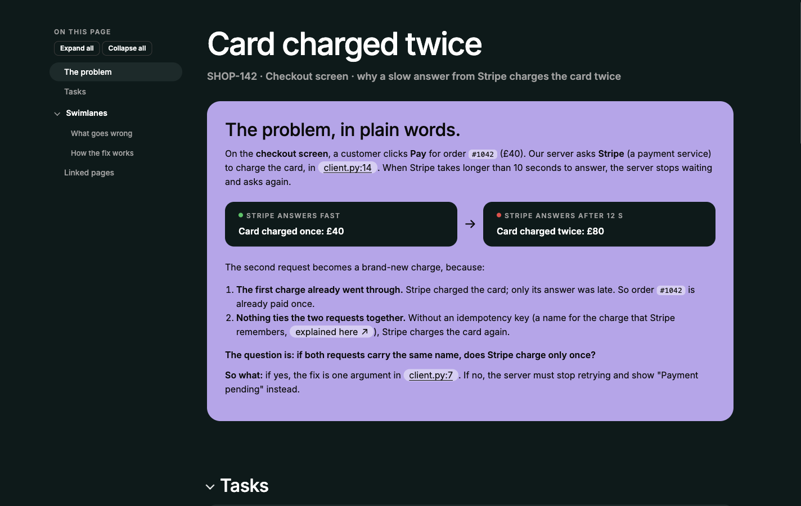
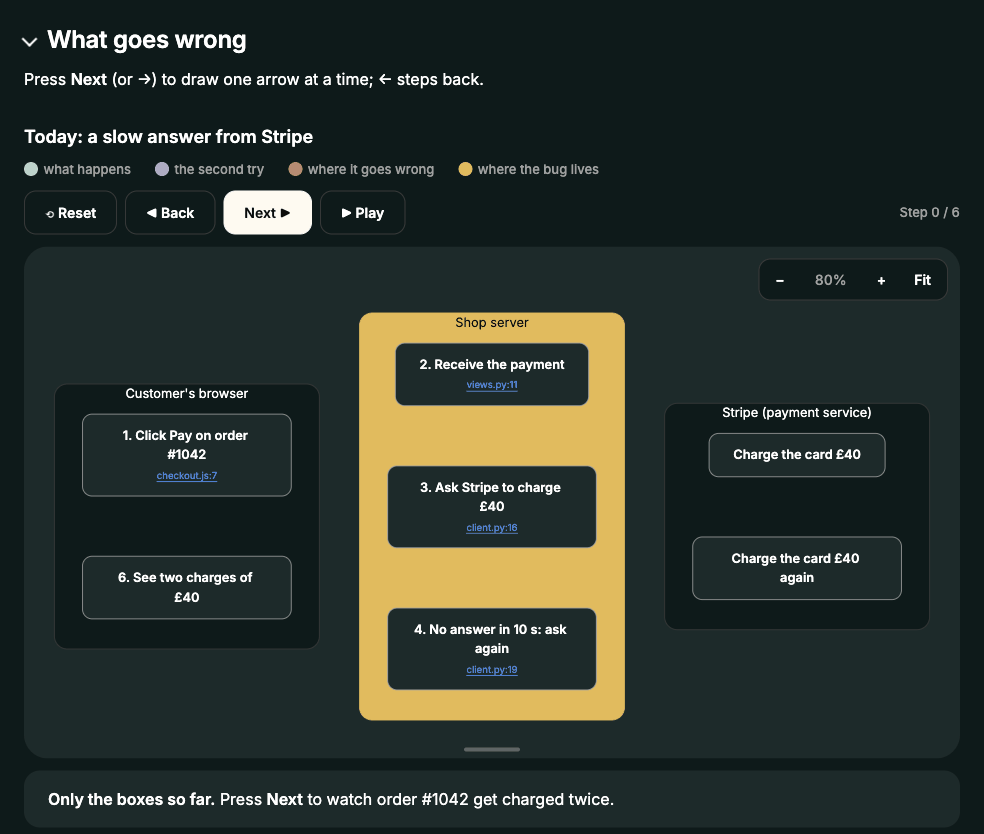
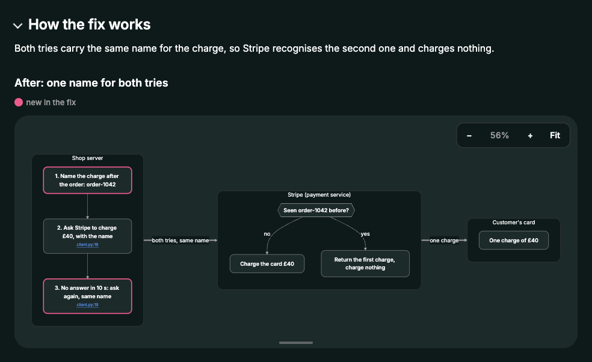
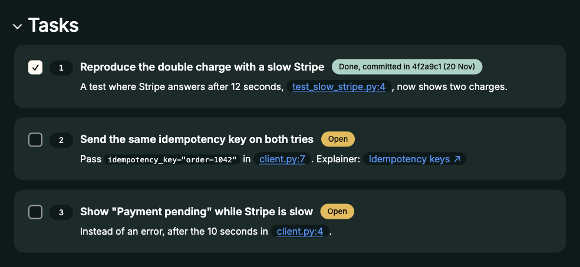

# html-explainer

A skill for coding agents that explains code, bugs and tickets as a single HTML page: swimlane
diagrams instead of walls of text, links that open the code at the right line, and nothing the
question didn't ask for.



## Features

- **One HTML file per page.** Opens in any browser; nothing to build or host.
- **Swimlane diagrams.** One box per system, each step inside the box that does it. The panel can be
  resized, zoomed and dragged, and clicking a box opens its file at that line in VS Code.
- **Playable swimlanes.** Reset / Back / Next / Play draws the flow one arrow at a time, with a caption
  for each step. The arrow keys work too.
- **The problem, in plain words.** A box that starts from the screen and a real example, with today's
  outcome next to the one in question.
- **Tasks.** Checkboxes and status labels, once the work is planned.
- **Links that say where they go.** Underlined opens a file at its line in VS Code, ↗ opens another
  page, and a plain link jumps to a section of the same page.
- **Linked pages.** A main page for a ticket and smaller pages for single questions, linked both ways.
- **A sidebar that follows you.** "On this page" highlights the section you are reading; sections fold
  away.
- **Checked before it is done.** The agent renders every diagram with Mermaid's command-line tool and
  fixes what breaks before it hands the page over.

## A closer look

A playable swimlane, stepping through a bug:



A plain swimlane, with the changed steps outlined:



Tasks, with file links and a link to another page:



The pages in these images come from a made-up ticket.

## Install

With the [skills](https://github.com/vercel-labs/skills) installer (needs Node.js 22.20 or later).

For every project on your machine:

```bash
npx skills add frhn-xo/html-explainer -g
```

For other options (one project only, choosing agents, updating, removing), see the
[skills documentation](https://github.com/vercel-labs/skills#readme).

## Using it

Ask your agent for an explanation page, for example:

- "Explain how the checkout retry works, using HTML."
- "What is the issue with this bug? Make me a page with a swimlane."
- "Draw a playable swimlane of what happens when a payment times out."

The page is saved next to your code; open it in a browser.

## Requirements

- Node.js, for the render check: every diagram is rendered with `npx -y @mermaid-js/mermaid-cli@11`
  before a page is called done.
- VS Code, for the file links (they open as `vscode://file/…`).
- The pages load Mermaid 11 from `cdn.jsdelivr.net`, so viewing them needs an internet connection.

## The design

Every page follows `skills/html-explainer/references/DESIGN.md`, a design analysis of Clay.com's
website, kept always dark. `assets/template.html` already carries its colours, type and spacing, so a
page looks right even when the agent never opens DESIGN.md; the agent reads it only for a colour or a
piece the template doesn't have.

## Contents

```
skills/html-explainer/
├── SKILL.md              # entry point: keep it minimal, which sections a request gets, workflow, checks
├── references/
│   ├── page.md           # file name, location, sidebar, links, task and Linked pages sections, master and explainer pages
│   ├── writing.md        # the problem section, defining terms, explaining what someone meant
│   ├── DESIGN.md         # the design every page follows (kept always dark, links as blue pills)
│   ├── diagrams.md       # how a swimlane looks, colours, fitting one screen, render check
│   └── playable.md       # playable swimlanes: markup, steps, captions
└── assets/
    ├── template.html     # starter page every new page is copied from
    ├── player.js         # engine for playable diagrams, pasted into a page
    └── player.css        # styles for playable diagrams
```

## License

MIT, see `LICENSE`.
